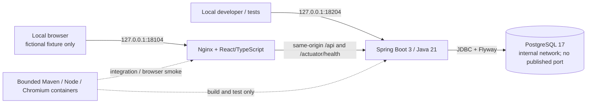

# Architecture

## Phase 1 topology

The shared backend network is Docker `internal: true`; PostgreSQL is attached only
there. API and web also attach to the project's existing tooling/ingress bridge so
Docker can actually publish their loopback ports without allocating a third network.
API/web therefore have outbound network capability, but no outbound integrations; this
is not a deny-all egress firewall or an agent execution environment. See D011.

## Repository boundaries

- `apps/web`: presentation, typed HTTP client, frontend tests.
- `services/api`: Spring Boot entry point, bootstrap-only HTTP handlers,
  validation/error handling, JDBC persistence, Flyway, backend tests.
- `packages/contracts`: hand-maintained OpenAPI contract for implemented routes.
- `infra/docker`: Compose and Nginx configuration.
- `tests/e2e`: real Chromium smoke tests and request-level runtime checks.
- `scripts`: project-scoped local orchestration and verification.
- `docs`: requirements, safety, decisions, plan, and verified evidence.

The guide's `services/worker` and `benchmarks` areas are deferred: empty placeholder
services or fabricated benchmark scripts would imply scope that is not built.

## Interfaces

| Route                            | Behavior                                                                             |
| -------------------------------- | ------------------------------------------------------------------------------------ |
| `GET /actuator/health/liveness`  | Process liveness, independent of DB availability                                     |
| `GET /actuator/health/readiness` | Readiness state plus an actual DB check; 503 if DB is unavailable                    |
| `POST /api/bootstrap/probes`     | Accept exactly `{"fixture":"phase-1-synthetic"}`; persist/read singleton; return 200 |
| `GET /api/bootstrap/probes/{id}` | Read persisted probe by UUID; 404 if absent, 400 for invalid UUID                    |

Probe JSON: `id` (UUID), `fixture` (fixed string), `createdAt` (UTC ISO timestamp).
Failures use `application/problem+json` with `type`, `title`, `status`, `detail`, and
`requestId`. Responses carry a server-generated UUID `X-Request-ID`. Request bodies,
credentials, arbitrary client IDs, and SQL are not logged.

The browser uses relative URLs; no permissive CORS is enabled. A small Origin guard
rejects unexpected browser Origins on mutation routes. Requests without an Origin (local
CLI/tests) are allowed; this is deliberately not authentication.

## Persistence and migration ownership

Flyway V1 creates only `bootstrap_probes`. Its fixture column has a unique constraint
and a check constraint permitting just the fixed synthetic fixture. An upsert preserves
the existing UUID and creation timestamp on repeated checks. The table is bounded to one
row, so smoke tests do not require destructive cleanup.

This is infrastructure evidence, not the domain data model from Phase 2. No ORM schema
auto-generation is used. Applied migrations are immutable. A V1 rollback would drop the
table and discard its fictional row; it requires explicit approval and is not run
automatically. Prefer reviewed forward migrations.

## Configuration and toolchain

Java 21, Spring Boot 3.5.x, Node 22 LTS, React/TypeScript, PostgreSQL 17, and Nginx.
Versions of package dependencies are pinned and locked. Published versions and Node
engine compatibility are checked before installation. Maven and Node compile into
project-local ignored build directories; runtime images mount only built artifacts and
runtime configuration read-only.

Before Java starts, its packaged JAR is copied once into a 96 MiB tmpfs, still within
the API's 512 MiB memory ceiling. The runtime snapshot avoids slow random Windows
bind-mount reads and remains unchanged during subsequent source builds. API/web are
explicitly recreated after builds. Database storage is preserved.

The local entry script generates a password with a cryptographic RNG only when missing.
Docker secrets mount it as a file; Spring consumes it through a configuration tree. It
is never put in the Compose environment or command line.

This compiled-artifact Compose layout avoids unbounded Docker build workers and keeps
every compiler/test runner under explicit memory/CPU/PID limits. It is for local
development, not a distributable production image pipeline.

## Resource budgets

| Service                     | Memory limit | CPU ceiling | PID ceiling |
| --------------------------- | ------------ | ----------- | ----------- |
| PostgreSQL                  | 256 MiB      | 0.50        | 128         |
| API                         | 512 MiB      | 0.75        | 128         |
| Web                         | 96 MiB       | 0.25        | 64          |
| Java tools (one at a time)  | 1024 MiB     | 1.00        | 256         |
| Node tools (one at a time)  | 768 MiB      | 1.00        | 256         |
| Chromium smoke (one worker) | 768 MiB      | 1.00        | 256         |

Runtime total is capped at 864 MiB. Verification runs tooling sequentially to avoid
compounding compiler/browser peaks. Database storage is a named volume scoped by the
Compose project. No host database port, Docker socket mount, privileged container,
shared host directory, global pruning, or arbitrary mount is part of the application.

## Deferred architecture

Redis and Kafka have no justified Phase 1 use and are not started. Future event
contracts are `run.started`, `action.recorded`, `snapshot.created`, `run.graded`. Domain
interfaces, permissions, idempotency, state transitions, and the worker boundary are
Phase 2+ design work. OpenTelemetry export is deferred to Phase 5; structured logs and
request IDs are the Phase 1 observability baseline.
